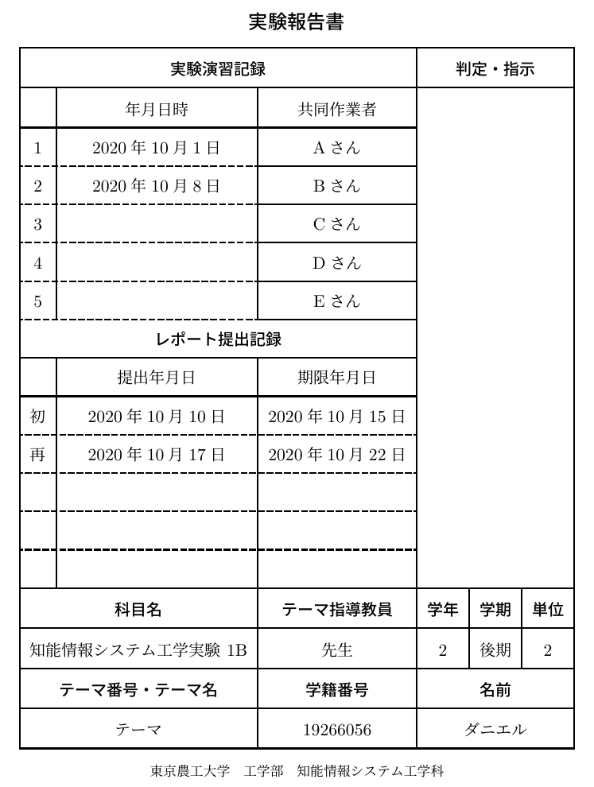

# 知能情報システム工学実験表紙(LaTeX 版)

[](https://github.com/pineapplehunter/tuat-tex/actions)

> [!NOTE]
> **お知らせ**
> このレポジトリは現在メンテナンスされていません。
> 保守や改善をお手伝いいただける方は、issue またはメールでご連絡ください。



## 旧バージョン（v1）

従来の `\tuatgakunen`、`\date1`、`\maketitle` などを使う文書には、
[v1 タグ](https://github.com/pineapplehunter/tuat-tex/tree/v1)のスタイルファイルと使い方を参照してください。
現在のインターフェース（v2）は従来版と互換性がありません。

## 使い方

`tuatreporttitle.sty` を自分の作業ディレクトリに置き、次のように使います。

```latex
\usepackage{tuatreporttitle}

\tuatsetup{
  name       = {ダニエル},                   % 名前
  student-id = {19266056},                   % 学籍番号
  year       = {2},                          % 学年
  semester   = {後期},                       % 学期
  credits    = {2},                          % 単位数
  course     = {知能情報システム工学実験 1B}, % 科目名
  theme      = {テーマ},                     % テーマ番号・テーマ名
  instructor = {先生},                       % テーマ指導教員
  experiment-dates = {2020年10月1日, 2020年10月8日}, % 実験日（実施順）
  collaborators    = {Aさん, Bさん, Cさん, Dさん, Eさん}, % 共同作業者
  submission-dates = {2020年10月10日, 2020年10月17日}, % 提出日（提出順）
  due-dates        = {2020年10月15日, 2020年10月22日}, % 提出期限
}

\begin{document}
\maketuatcover
% ここからレポート本文
\end{document}
```

- `\tuatsetup{...}` は繰り返し呼べます。指定した項目だけを更新します。
- `title` の初期値は「実験報告書」、`year` は `1`、`semester` は「前期」、`credits` は `2` です。それ以外の未指定項目は空欄になります。
- `experiment-dates`、`collaborators`、`submission-dates`、`due-dates` はカンマ区切りのリストです。再指定するとそのリスト全体を置き換えます。空にするには `collaborators = {}` のように指定します。
- `submission-dates` と `due-dates` は提出順に指定します。最初の提出日に「初」、2回目以降の提出日に「再」を表示します。日付の形式は自由です。
- 通常の値に半角カンマを含む場合は `theme = {テーマA, テーマB}` のように波括弧で囲んでください。リスト内の一項目にカンマを含む場合は `collaborators = {{Last, First}, Bさん}` のようにさらに囲みます。値の中で `\textbf{...}` などの LaTeX コマンドも使えます。
- 実験日・共同作業者・提出記録にはそれぞれ最低5行の記入欄を用意します。6件以上も表示しますが、表全体を同じ大きさに合わせるため文字や行は小さくなります。
- `geometry` は自動で読み込みます。表紙の後は元の余白に戻り、本文のページ番号は1から始まります。標準の `\title`、`\author`、`\date`、`\maketitle` は変更しません。表紙の情報は `\tuatsetup` で指定してください。

## サンプル

- `sample-xelatex.tex`：XeLaTeX / [Tectonic][] 用
- `sample-platex.tex`：pLaTeX 用（`platex` の後に `dvipdfmx` で PDF に変換）

### Tectonic

```sh
tectonic sample-xelatex.tex
```

### pLaTeX

```sh
platex -halt-on-error sample-platex.tex
dvipdfmx sample-platex.dvi
```

## テスト環境

| 名称 | 設定 |
| ---- | ---- |
| LaTeX | [Tectonic][]（XeTeX）、pLaTeX + dvipdfmx |
| サイズ | A4 |

[tectonic]: https://tectonic-typesetting.github.io/en-US/

## 参考

初めて LaTeX を書く人は Tectonic というプログラムを使うことをおすすめします。
私が記事を書いているので参考にしてみてください。
https://students-tech.blog/post/tectonic.html#latex%E3%81%A8%E3%81%AF

## 質問・要望

ご質問やご要望があれば、このレポジトリに issue か Pull Request を送るか、次のメールアドレスにご連絡ください。

shogo-takata@st.go.tuat.ac.jp
